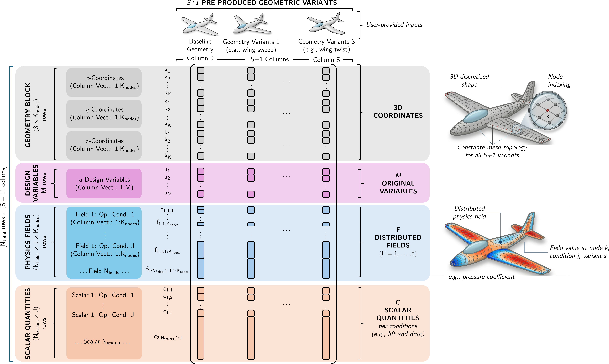

# Input data structure

PME-toolkit operates on datasets describing the variability of parametric geometries.

## Data components

A dataset typically includes:

- geometric data
- design variables
- physical quantities (required for PI-PME / PD-PME)

---

## Global data matrix

PME-toolkit represents all information through a **block-structured data matrix**, where each column corresponds to one design realization.

**Figure:** Structure of the PME data matrix. Geometry, design variables, optional distributed fields, and scalar quantities are stacked into a single matrix. This unified representation enables dimensionality reduction while preserving the link to the original parametric variables.

---

## Geometry representation

Geometry is represented as a matrix:

$$
D \in \mathbb{R}^{n_{\text{features}} \times n_{\text{samples}}}
$$

Where:

- n_samples = number of design realizations
- n_features = number of geometric degrees of freedom

Typical cases:

- 2D geometry → stacked coordinates
- 3D geometry → flattened mesh nodes

Within each geometry patch, rows store all point coordinates in the first
direction, then the second direction, and then the third when present.
Columns remain design samples. Thus a 3D patch with `K` points contributes
`3*K` rows; multiple patches follow the order in `geom.patches`.

---

## Design variables

Design variables are stored as:

$$
U \in \mathbb{R}^{n_{\text{variables}} \times n_{\text{samples}}}
$$

These correspond to the original parametric model and are explicitly included in the data matrix, enabling **analytical backmapping** from the reduced space.

---

## PME embedding matrix

The fitting matrix depends on `mode`:

$$
\mathbf{P}_{\mathrm{PME}}=[\mathbf{D};\mathbf{U}],\qquad
\mathbf{P}_{\mathrm{PI}}=[\mathbf{D};\mathbf{U};\mathbf{F};\mathbf{C}],\qquad
\mathbf{P}_{\mathrm{PD}}=[\mathbf{U};\mathbf{F};\mathbf{C}].
$$

Here `U` contains the prepared active design variables, `F` the configured
physical fields and `C` the scalar responses. The input database retains its
configured row layout in all three modes; PD-PME excludes geometry when
constructing the fitting matrix. Both solvers use the same matrix and metric.

---

## Optional physical data

PI-PME and PD-PME require at least one configured physical source, such as:

- pressure fields
- performance indicators

Fields and scalars are included in the order specified by `phys.fields` and
`phys.scalars`. Native rows have zero metric weight but are retained in the
recovered modes for analytical backmapping. See [Configuration](config_spec.md)
for the required physics declarations and [Snapshot formulation](snapshot.md)
for mode recovery.

---

## Key requirement

All data must be:

- aligned sample-wise
- consistent in dimension
- free of missing values (after filtering)

---

## Summary

The entire PME workflow relies on a **consistent data matrix representation**, where each column represents one design realization and multiple data sources are combined into a unified embedding space.
