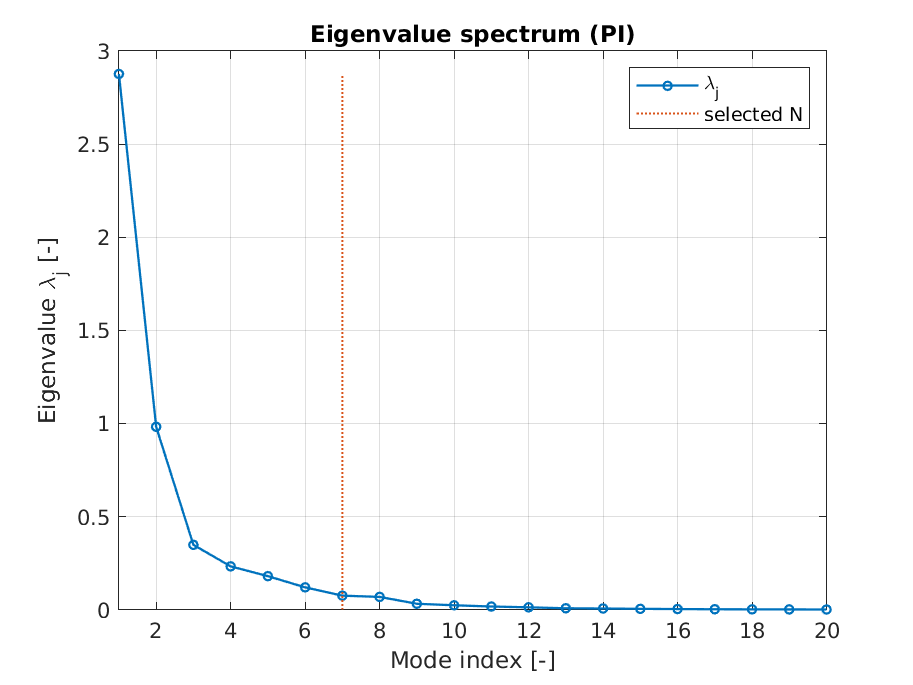
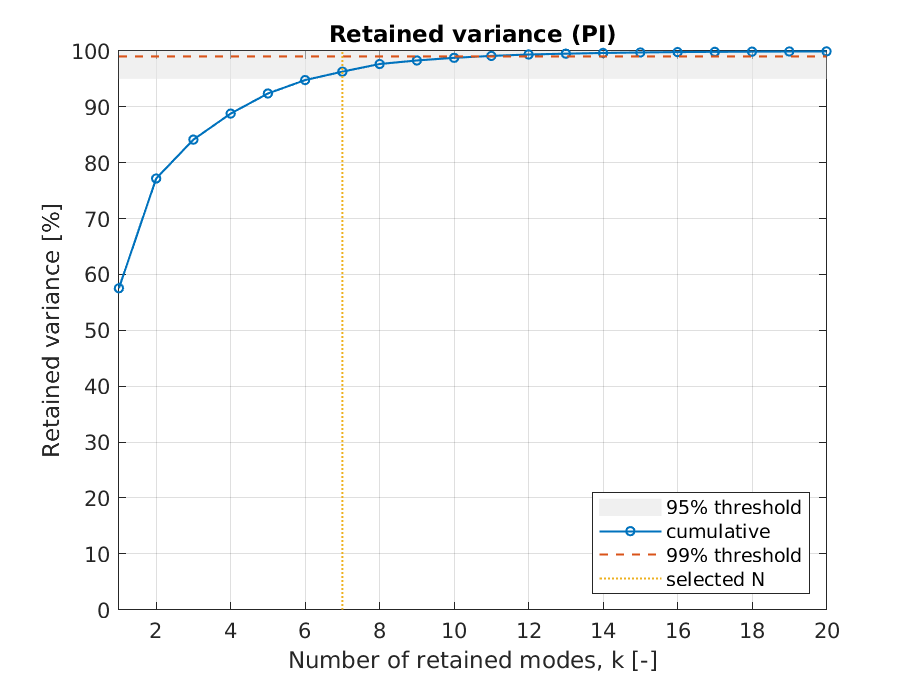
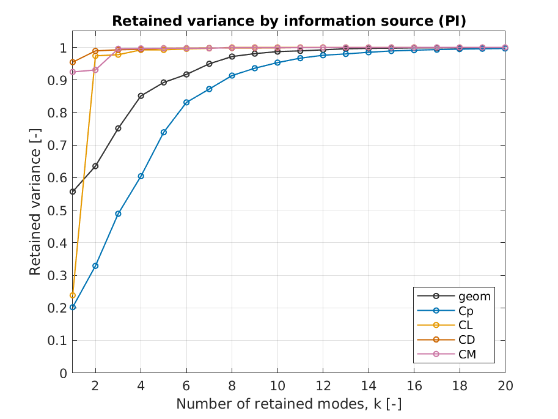
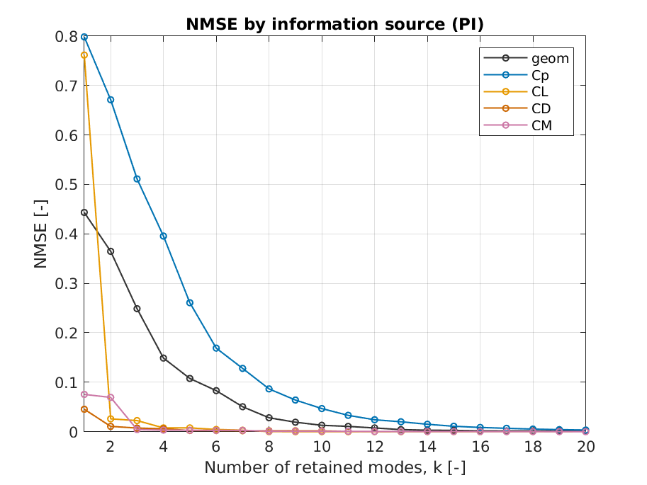
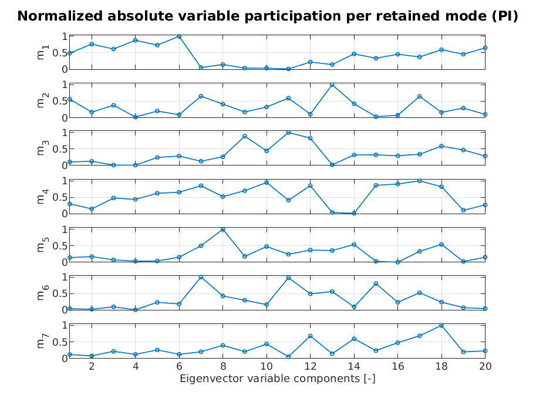
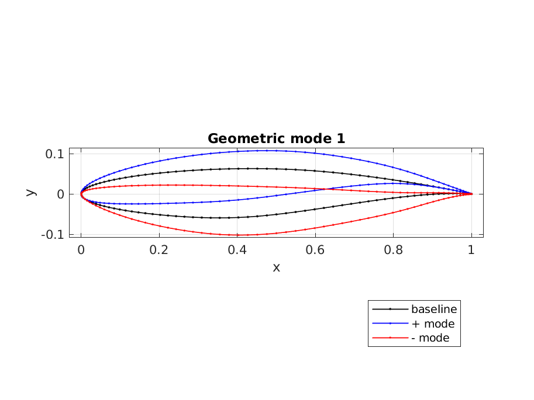

# Visualization

PME-toolkit automatically generates visualization figures during the benchmark workflow.

These figures help interpret the dimensionality reduction results produced by PME, PI-PME, and PD-PME and evaluate the quality of the reduced representation.

The figures on this page illustrate the glider and airfoil benchmark outputs.

The normal MATLAB and Python case workflows generate plots in `io.outdir`.
The Python runner also provides `--no-plots` to skip figures.

---

## Visualization workflow

Visualization figures are generated automatically when running a benchmark case.

After execution, the configured output directory contains the generated figures
and report data. Relative output paths are interpreted from the case directory.

A typical results directory contains files such as:

```
results/
- report.mat
- scree_plot.png
- variance_retained.png
- variance_by_source.png
- nmse_by_source.png
- variable_modes_normalized.png
- mode_01.png
- mode_02.png
- mode_03.png
```

Model saving adds `model.npz` in Python or `model.mat` in MATLAB. The exact
files depend on the configuration and available source blocks. In particular,
PD-PME does not generate geometric-mode figures because its embedding excludes
geometry.

`direct`, `snapshot` and `auto` use the same plotting functions and output
names. The physical modes recovered by snapshot are used in the figures;
the eigenvectors of the sample Gram matrix are not plotted as geometry.

---

## Eigenvalue spectrum (Scree plot)

The scree plot shows the eigenvalue spectrum associated with the embedding.
Only the numerically resolved positive spectrum is returned and plotted.



A rapid decay of the eigenvalues indicates that most of the relevant variability of the design space can be captured using a small number of retained modes.

This plot is useful to assess:

- intrinsic dimensionality of the design space
- relative importance of successive modes
- potential truncation levels for the reduced representation

---

## Retained variance

The cumulative retained variance indicates how much of the total variance of the embedding is captured by the retained modes.



Typical thresholds used in dimensionality reduction include:

- 95% retained variance
- 99% retained variance

The denominator is the full weighted trace before numerical-rank truncation.
The selected dimension reaches the requested threshold while keeping the
complete eigenvalue cluster at the boundary. When unresolved variance prevents
the target from being reached, all resolved modes are retained and the achieved
fraction is reported.

---

## Retained variance by information source

When multiple information sources are included in the embedding (for example geometry and physical quantities), it is useful to analyze how the retained variance is distributed across them.



This plot helps understand:

- whether the embedding is mainly driven by geometry
- whether physical observables contribute significantly
- how balanced the reduced representation is across heterogeneous sources

This analysis is particularly relevant for PI-PME and PD-PME workflows.

---

## Reconstruction error by information source

The normalized mean squared reconstruction error (NMSE) can also be analyzed separately for each information source.



This plot indicates how accurately the reduced representation reconstructs each component of the dataset.

Lower NMSE values indicate better reconstruction accuracy.
The global NMSE uses weighted residual energy with the same metric as fitting.
Constant sources contribute no variance to the retained-variance curves.

This visualization is useful to compare reconstruction quality across heterogeneous data sources.

---

## Variable participation in retained modes

When design variables are included in the embedding, their contribution to the retained modes can be visualized.



This plot shows the normalized absolute contribution of each design variable to each retained mode.

It helps interpret the reduced coordinates and identify which original variables most strongly influence the latent representation.

---

## Geometric modes

The geometric interpretation of the reduced coordinates can be visualized through modal perturbations of the baseline geometry.

<p align="center">
  
</p>

<p align="center"><em>Example of first geometric mode of the PME embedding for the airfoil benchmark.</em></p>

The mode perturbations use the baseline geometry and the geometric part of the
recovered mode, with amplitude `3*sqrt(lambda)`. Reversing an eigenvector's sign
exchanges the positive and negative curves. Repeated eigenvalues can admit
different modal bases for the same subspace.

In this figure:

- the black curve represents the baseline configuration
- the blue curve represents the positive perturbation along the mode
- the red curve represents the negative perturbation

This visualization provides an interpretation of how each reduced coordinate
modifies the original geometry. For PD-PME, geometric reconstruction instead
requires native backmapping and the user's geometry generator.

---

## Interpreting the visualizations

The different plots should be interpreted together to obtain a complete understanding of the reduction quality.

Important considerations include:

- eigenvalue decay indicates intrinsic dimensionality
- retained variance quantifies global information preservation
- source-wise variance highlights the contribution of heterogeneous data
- NMSE measures reconstruction accuracy
- variable participation supports interpretability
- geometric modes reveal deformation patterns associated with the reduced coordinates

Together, these visualizations support both quantitative evaluation and qualitative interpretation of the reduced design space.

---

## Notes

The exact appearance and number of generated figures depend on the selected benchmark configuration and the information sources included in the embedding.

Visualization is included in both language workflows. The advanced
`fit_streaming` API returns a compact native model and does not automatically
produce this standard plot set. Geometric plots from streamed fits require
recovered observation modes and the corresponding geometry metadata; an
optional mode writer can save those modes without retaining them all in memory.

For benchmark setup and execution, see the documentation pages on Benchmarks, Datasets, and Reproducibility.
